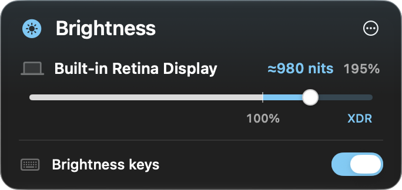

# DisplayPolish

[Русский](README.ru.md) · [Download for Apple silicon](https://github.com/ex3lite/DisplayPolish/releases/latest)

DisplayPolish is a macOS menu bar app for extending brightness past 100% on compatible XDR and HDR displays. Adjust each display separately, or use the brightness keys on the display under the pointer. Free and open source under the MIT license.


[Watch the MP4 demo](https://github.com/ex3lite/DisplayPolish/releases/latest/download/DisplayPolish-demo.mp4)

## Install

Requires an Apple silicon Mac running macOS 26.3 or later and a compatible XDR or HDR display.

1. [Download the DMG](https://github.com/ex3lite/DisplayPolish/releases/latest/download/DisplayPolish-macOS-arm64.dmg).
2. Open the disk image and drag **DisplayPolish** to **Applications**.
3. Open DisplayPolish from Applications and look for the sun in the menu bar.

The app is signed ad hoc and has no Apple notarization ticket. If Gatekeeper blocks the first launch, follow [Apple’s instructions for opening an app you trust](https://support.apple.com/en-us/102445).

### Install from Terminal

```sh
installer=$(mktemp -t displaypolish-install)
curl -fsSL https://raw.githubusercontent.com/ex3lite/DisplayPolish/v0.1.1/install.sh -o "$installer" &&
  /bin/bash "$installer"
rm -f "$installer"
```

The installer downloads the latest release, checks its SHA-256 and code signature, and opens the app from `~/Applications`. Run it again to update. Quit DisplayPolish from its menu before updating an installed copy.

## Use

1. Open the sun icon in the menu bar. Move a compatible display’s slider past **100%** to enable XDR. Return it to **100%** to leave XDR on that display.
2. For the brightness keys, choose **Grant Access…** and enable DisplayPolish under **Accessibility** in System Settings. The keys then control the compatible display under your pointer. At 100%, another increase enters XDR.
3. For an external HDR display, enable HDR in macOS Display settings first.



The HUD shows the 100% threshold, XDR zone and a luminance reading when available. On supported built-in Apple panels, DisplayPolish sets luminance through the panel driver. Other compatible displays use Metal, with luminance estimated when macOS exposes calibration. Direct brightness was verified on a 16-inch M1 Max MacBook Pro. Display capability, the active preset and macOS affect the available range. Direct XDR uses private system interfaces.

The interface follows the preferred app language in macOS. English and Russian are included.

## Build from source

Open `DisplayPolish.xcodeproj` in Xcode with the macOS 26.3 SDK or newer and run the **DisplayPolish** scheme. To build the release DMG, ZIP and checksums, run `./scripts/package-release.sh`.

For development with a consistent signing identity, set `CODE_SIGN_IDENTITY` in an untracked `Signing.local.xcconfig` next to `Signing.xcconfig`. An ad hoc rebuild can require granting Accessibility again. If macOS shows DisplayPolish as enabled but the app still asks for access, remove the old entry and add the current build. [Apple’s code-signing notes](https://developer.apple.com/documentation/technotes/tn3127-inside-code-signing-requirements)

[MIT license](LICENSE) · [Technical notes in Russian](docs/betterdisplay-research.md)
