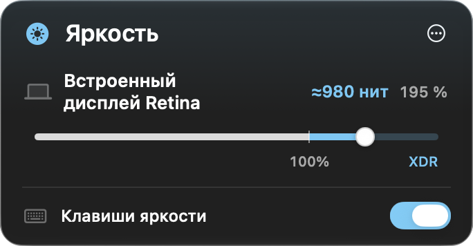

# DisplayPolish

[English](README.md) · [Скачать для Apple silicon](https://github.com/ex3lite/DisplayPolish/releases/latest)

DisplayPolish повышает яркость совместимых XDR- и HDR-дисплеев выше 100%. У каждого дисплея свой уровень. Штатные клавиши яркости регулируют экран под указателем. Приложение бесплатное, исходный код опубликован под лицензией MIT.


[Посмотреть демонстрацию в MP4](https://github.com/ex3lite/DisplayPolish/releases/latest/download/DisplayPolish-demo.mp4)

## Установка

Нужен Mac с Apple silicon, macOS 26.3 или новее и совместимый дисплей XDR или HDR.

1. [Скачайте DMG](https://github.com/ex3lite/DisplayPolish/releases/latest/download/DisplayPolish-macOS-arm64.dmg).
2. Откройте образ и перетащите **DisplayPolish** в папку **«Программы»**.
3. Запустите DisplayPolish из папки «Программы». В строке меню появится значок солнца.

Приложение подписано ad hoc и выпущено без нотарификации Apple. Если Gatekeeper заблокирует первый запуск, воспользуйтесь [инструкцией Apple для доверенных приложений](https://support.apple.com/ru-ru/102445).

### Установка через Терминал

```sh
installer=$(mktemp -t displaypolish-install)
curl -fsSL https://raw.githubusercontent.com/ex3lite/DisplayPolish/v0.1.1/install.sh -o "$installer" &&
  /bin/bash "$installer"
rm -f "$installer"
```

Установщик скачает последний релиз, проверит SHA-256 и подпись, установит приложение в `~/Applications` и откроет его. Для обновления выйдите из DisplayPolish через его меню и повторите команду.

## Использование

1. Нажмите значок солнца в строке меню. Сдвиньте ползунок нужного дисплея правее **100%**, чтобы включить XDR. Верните ползунок на **100%**, чтобы выключить усиление на этом дисплее.
2. Для управления клавишами нажмите **Разрешить доступ…** и включите DisplayPolish в разделе «Универсальный доступ» системных настроек. Клавиши будут регулировать совместимый дисплей под указателем. На 100% следующее нажатие повышения включает XDR.
3. Для внешнего HDR-дисплея сначала включите HDR в настройках дисплеев macOS.



На экранной шкале видны граница 100%, зона XDR и яркость в нитах, когда её можно получить. Для совместимых встроенных панелей Apple DisplayPolish задаёт яркость через драйвер. На других совместимых дисплеях усиление работает через Metal, а оценка в нитах доступна при наличии калибровки. Аппаратный режим проверен на 16-дюймовом MacBook Pro с M1 Max. Доступный диапазон зависит от панели, профиля и macOS. Для аппаратного XDR используются приватные системные интерфейсы.

Приложение использует предпочитаемый язык macOS. Доступны русский и английский.

## Сборка из исходников

Откройте `DisplayPolish.xcodeproj` в Xcode с SDK macOS 26.3 или новее и запустите схему **DisplayPolish**. Чтобы собрать DMG, ZIP и контрольные суммы, выполните `./scripts/package-release.sh`.

Для постоянной подписи при разработке задайте `CODE_SIGN_IDENTITY` в локальном `Signing.local.xcconfig` рядом с `Signing.xcconfig`. После пересборки с подписью ad hoc macOS может запросить доступ заново. Если в настройках доступ включён, а приложение продолжает его запрашивать, удалите старую запись и добавьте текущую сборку. [Техническая заметка Apple о подписи](https://developer.apple.com/documentation/technotes/tn3127-inside-code-signing-requirements)

[Лицензия MIT](LICENSE) · [Технические заметки](docs/betterdisplay-research.md)
